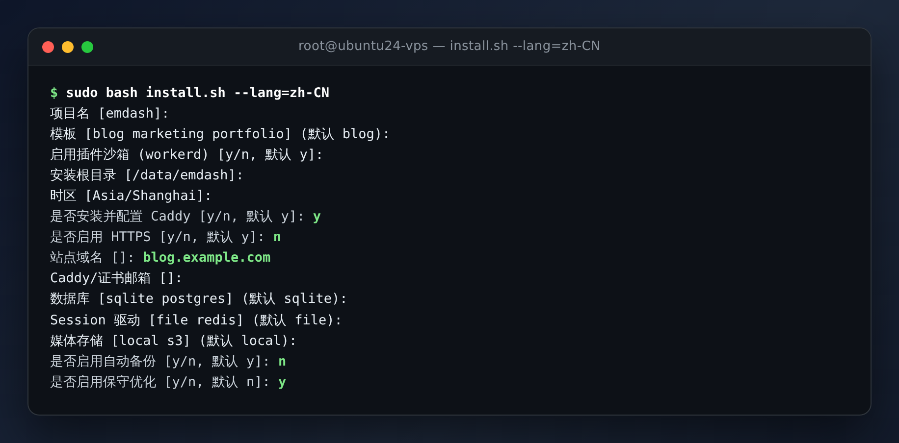
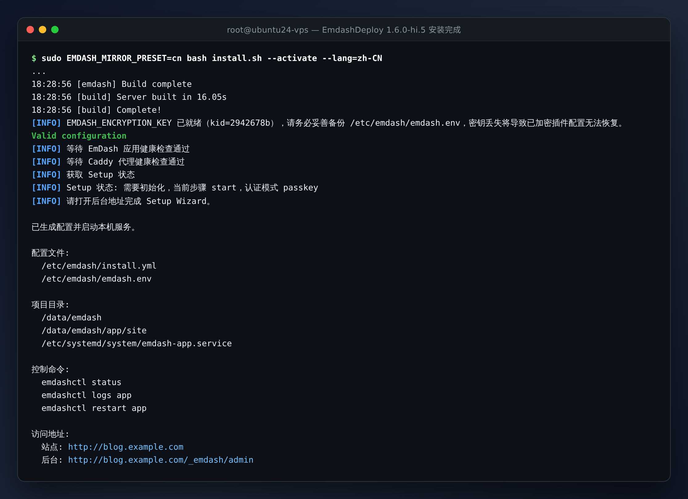
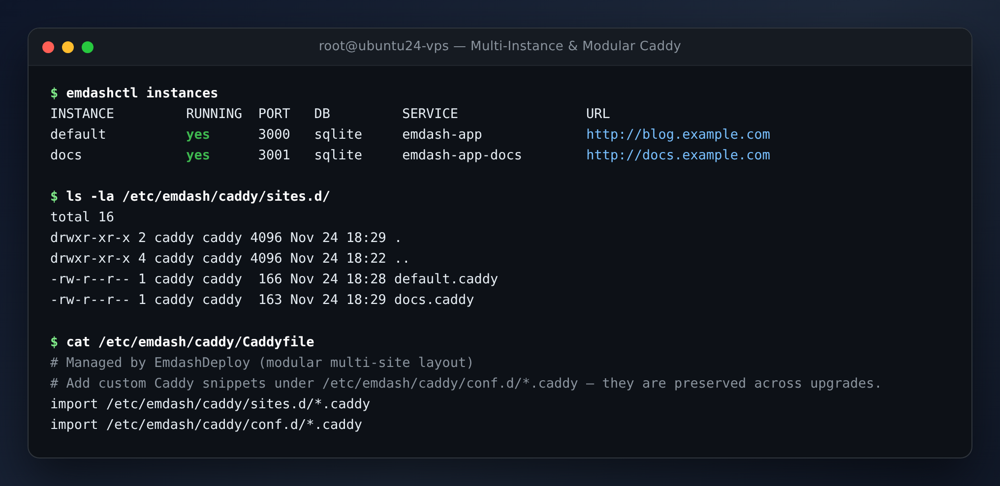
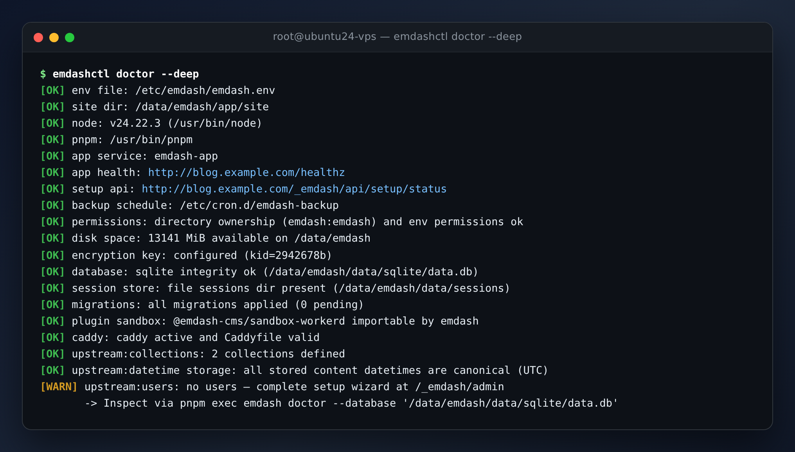
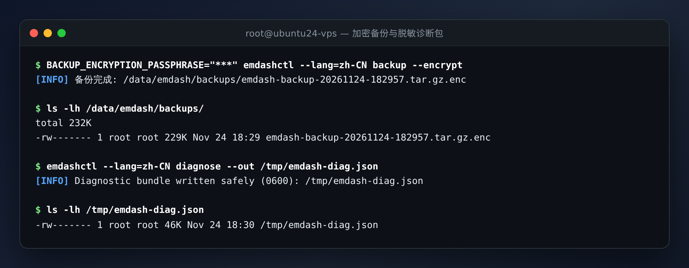
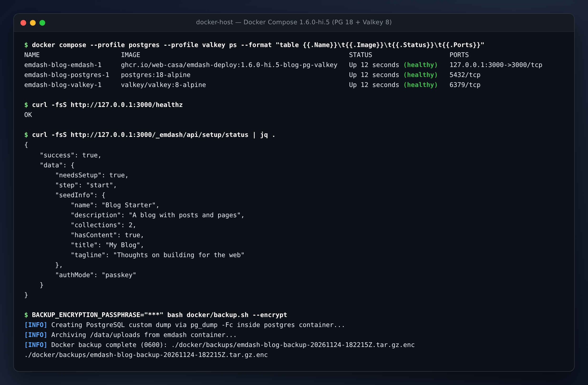

# EmdashDeploy

[](https://github.com/web-casa/EmdashDeploy/releases)
[](https://github.com/web-casa/EmdashDeploy/actions/workflows/ci.yml)
[](./LICENSE)
[](#支持平台与实测矩阵)
[](#支持平台与实测矩阵)
[](#部署方式选型)

面向 [EmDash](https://github.com/emdash-cms/emdash) `1.6.x` 的生产级 **VPS 原生安装器**、**全生命周期运维 CLI（`emdashctl`）** 与 **多服务共存优先的多架构 Docker Compose 套件**。

**语言**：[English](./README.md) | **简体中文** | [繁體中文](./README.zh-TW.md) | [日本語](./README.ja.md) | [한국어](./README.ko.md) | [Español](./README.es.md) | [Deutsch](./README.de.md) | [Français](./README.fr.md) | [Português](./README.pt.md)

---

## 部署方式选型

两种部署模式均位于 `main` 分支，共用同一套 EmDash `1.6.x` 配置补丁引擎（[`lib/site-common.sh`](./lib/site-common.sh) 与 [`lib/astro-patch.py`](./lib/astro-patch.py)）、`@emdash-cms/sandbox-workerd` 插件沙箱、密钥校验与数据库迁移安全门禁。

| 对比维度 | 原生 VPS 安装器（`install.sh` + `emdashctl`） | Docker Compose 套件（[`docker/`](./docker/README.md)） |
| --- | --- | --- |
| **适用场景** | 独立 VPS、更低内存开销、直接由宿主机 `systemd` + Caddy 管理 | 一台服务器与 Nginx / Traefik / 1Panel / 其他容器共存 |
| **运行栈** | 宿主机 Node.js 24、`systemd`、Caddy、SQLite / PostgreSQL 18、Valkey | 官方预构建双架构 GHCR 镜像（`linux/amd64` + `linux/arm64`） |
| **宿主机端口** | 可选宿主机 Caddy（`80/443`）或直接监听 `APP_PORT` | 默认**不占用 `80/443`**（仅监听 `127.0.0.1:3000`） |
| **单机多站点** | 原生 `--instance <name>` + 模块化 `/etc/emdash/caddy/sites.d/` | 通过 `COMPOSE_PROJECT_NAME` + `APP_PORT`（或 `compose.proxy-net.yml`） |
| **自定义 / AI 改造站点** | 默认 `preserve` 模式，绝不覆盖 `/data/emdash/app/site` 用户代码 | 通过 [`docker/Dockerfile.custom`](./docker/Dockerfile.custom) 不可变镜像构建 |
| **备份与恢复** | `emdashctl backup/restore`（支持本地 + S3 保留/列举/恢复闭环） | [`docker/backup.sh`](./docker/backup.sh) + [`docker/restore.sh`](./docker/restore.sh) |
| **双模式互迁** | [`scripts/migrate-runtime.sh`](./scripts/migrate-runtime.sh)（`native-to-docker` ↔ `docker-to-native`） | 同左 |

> 历史旧版 bash 容器安装脚本已归档至 `docker` 分支。

---

## 快速开始

### 方式一：原生 VPS 安装（交互式）

```bash
curl -fsSL https://raw.githubusercontent.com/web-casa/EmdashDeploy/main/bootstrap.sh | sudo bash -s -- --lang=zh-CN
```

非交互安装（SQLite + Caddy 自动 HTTPS）：

```bash
EMDASH_INSTALL_USE_CADDY=1 \
EMDASH_INSTALL_ENABLE_HTTPS=1 \
EMDASH_INSTALL_DOMAIN=blog.example.com \
EMDASH_INSTALL_ADMIN_EMAIL=ops@example.com \
curl -fsSL https://raw.githubusercontent.com/web-casa/EmdashDeploy/main/bootstrap.sh \
  | sudo -E bash -s -- --lang=zh-CN --non-interactive --activate
```

中国大陆网络加速安装（自动为 Corepack 与 `pnpm 11` 切换 `npmmirror` 镜像并开启 Google Fonts 构建期 fast-fail，不修改宿主机全局 APT/DNF 源，构建耗时从 ~120s 超时降至 ~16–19s）：

```bash
EMDASH_MIRROR_PRESET=cn \
curl -fsSL https://raw.githubusercontent.com/web-casa/EmdashDeploy/main/bootstrap.sh \
  | sudo -E bash -s -- --lang=zh-CN --non-interactive --activate
```

在同一台服务器上新增第二个隔离的原生实例：

```bash
sudo bash install.sh --lang=zh-CN --instance site2 --activate
```

零停服更新已有机器上的 `emdashctl` 与共享运行库（不重建、不重启运行中的站点）：

```bash
curl -fsSL https://raw.githubusercontent.com/web-casa/EmdashDeploy/main/bootstrap.sh | sudo bash -s -- --update-cli
```

### 方式二：Docker Compose 套件（预构建双架构 GHCR 镜像）

```bash
git clone https://github.com/web-casa/EmdashDeploy.git && cd EmdashDeploy/docker
cp .env.example .env
# 编辑 .env：设置 EMDASH_SITE_URL=https://blog.example.com 与 APP_PORT=3001
docker compose run --rm emdash secrets-generate
# 将生成的密钥填入 .env 的 EMDASH_ENCRYPTION_KEY，然后启动：
docker compose up -d
```

PostgreSQL 18 + Valkey 8 profiles、大陆本地加速构建（`compose.build.yml`）、自定义站点镜像（`compose.custom-site.yml`）、外部反代网络（`compose.proxy-net.yml`）以及容器加密备份/恢复与密钥轮转指南，详见 [`docker/README.md`](./docker/README.md)。

---

## 全流程实测截图

以下配图均在真实 Ubuntu 24.04 虚拟机与 Docker 宿主机上运行 **EmdashDeploy `1.6.0-hi.5`** 全链路采集（点击任意图片可查看大图）：

| 1. 交互式安装向导（`--lang=zh-CN`） | 2. 原生构建、Caddy 校验与完成摘要 |
| :---: | :---: |
|  |  |
| **3. EmDash `1.6.0` 博客前台实拍** | **4. `/_emdash/admin` Passkey 初始化向导** |
|  |  |
| **5. 单机多实例与模块化 Caddy（`sites.d/`）** | **6. 深度运维体检（`emdashctl doctor --deep`）** |
|  |  |
| **7. `0600` 加密备份与一键脱敏诊断包** | **8. Docker Compose `1.6.0-hi.5`（PG 18 + Valkey 8）** |
|  |  |

---

## 核心特性（`1.6.0-hi.6`）

- **完整适配 EmDash `1.6.x` 安全与运行时规范**：
  - 自动调用上游 `emdash secrets generate` 生成并校验 `EMDASH_ENCRYPTION_KEY`，支持**两阶段零丢失密钥轮转**（`emdashctl rotate-encryption-key`），阶段 2 裁剪旧密钥前自动扫描 SQLite / PostgreSQL 中的密文 `kid` 引用并要求 `--confirm-prune-kid <kid>`。
  - 默认开启 `@emdash-cms/sandbox-workerd` + `workerd` 插件隔离（可通过 `EMDASH_INSTALL_ENABLE_PLUGIN_SANDBOX=0` 关闭）。
  - 显式 `emdash migrate --status --json` 与 `--expected-target-fingerprint` 迁移门禁。
  - 完整写入 `APP_PUBLIC_URL` / `EMDASH_SITE_URL` / `SITE_URL`，避免 Passkey / WebAuthn `rp.id` origin 报错。
- **原生单机多实例与模块化 Caddy**：
  - 默认单实例路径（`/etc/emdash`、`/data/emdash`、`emdash-app.service`、端口 `3000`）100% 向下兼容。
  - 命名实例（`--instance <name>`）完全隔离配置、数据、systemd 服务、cron 备份、自动端口（`3001+`）、实例级 `HOME=${ROOT_DIR}`、`flock` 锁及独立 `emdash_<name>` PostgreSQL 库/用户。
  - 模块化 `/etc/emdash/caddy/Caddyfile`（单一全局 `email` 块 + 托管 `sites.d/*.caddy` + 用户自定义 `conf.d/*.caddy` 跨升级/卸载持久保留；旧版单文件 `Caddyfile` 扩展多实例时自动平滑迁移为 `sites.d/default.caddy`）。
- **无损依赖升级与只读模板对比**：
  - `emdashctl upgrade app` 仅升级 `emdash` / `@emdash-cms/*` 依赖，自动加排他锁、做校验备份、执行构建与显式数据库迁移门禁，**绝不覆盖用户自定义页面、样式与 `astro.config.mjs`**。
  - `emdashctl template diff [--stat]` 只读对比上游模板变更。
- **面向 AI 的一键脱敏诊断包**：
  - `emdashctl diagnose --json [--out <file>]`（`schema_version: 1`）聚合宿主机信息、脱敏配置摘要（`encryption_key_kids`）、`doctor --deep`（含 SQLite 上游 `emdash doctor`）、迁移状态、服务状态、受限 `journalctl -o json` 日志与修复建议。
  - 递归脱敏密码、数据库/Redis URL、`emdash_enc_v1_*`、Bearer/Basic 头、Cookie、JWT、敏感查询参数与客户端 IP（`--out` 拒绝软链并以 `0600` 原子写入）。
- **完整本地 + S3 备份/保留/恢复闭环**：
  - SQLite 使用 `sqlite3.backup()` + `PRAGMA integrity_check`，PostgreSQL 使用 `pg_dump -Fc` + `pg_restore --list`，带 `manifest.json` + SHA-256 校验、`0600` 权限与可选 AES-256-CBC PBKDF2 加密（`--encrypt`）。
  - 支持 `BACKUP_KEEP_S3`（默认 `14`，严格仅清理受管备份文件）、`backup --list-s3 [--json]` 与 `restore --from-s3 <key|latest>`。
- **数据库与运行时迁移助手**：
  - `emdashctl migrate-db sqlite-to-postgres`：零外部依赖迁移工具（[`lib/migrate-sqlite-to-pg.py`](./lib/migrate-sqlite-to-pg.py)），支持非超级用户外键拓扑排序、PG 列类型转换（原样保留 `$emdash` 密文信封）、自动跳过 SQLite 专属 `_emdash_fts_*` 影子表、自动在 PG 创建缺失的 `ec_*` 动态集合表（如 `ec_posts`/`ec_pages`）、序列重置、逐表行数强校验及失败自动回滚。
  - [`scripts/migrate-runtime.sh`](./scripts/migrate-runtime.sh)：支持 `native-to-docker` 与 `docker-to-native` 双向迁移，原样保留 `EMDASH_ENCRYPTION_KEY` 并生成 `0600` 权限的 `.env`。
- **安全卸载**：
  - `emdashctl uninstall` 清理目标实例的 systemd、cron、Caddy 片段与配置，绝不误伤同机兄弟实例与 `conf.d/*.caddy`；破坏性参数 `--purge-data` / `--drop-db` 必须显式传入 `--confirm-instance <name>`（绝不接受单独 `--yes`）。

---

## 运维命令速查（`emdashctl`）

所有实例级命令均支持 `[--lang <code>]` 与 `[--instance <name>]`（省略 `--instance` 时操作默认主实例）。

| 命令 | 说明 |
| --- | --- |
| `emdashctl instances [--json]` | 列出宿主机上所有原生实例的运行状态、端口、数据库驱动与 URL |
| `emdashctl status [--json]` | 查看运行状态、健康检查、Setup 状态、数据库、Session 与 Caddy 状态 |
| `emdashctl doctor [--deep] [--json]` | 检查权限、属主、迁移状态与上游 `emdash doctor` 诊断结果 |
| `emdashctl diagnose [--json] [--lines N] [--out FILE]` | 导出全面脱敏的 AI 诊断包（`0600` 原子写入，拒绝软链） |
| `emdashctl smoke [--json]` | 执行本地 HTTP 与 Setup API 冒烟测试 |
| `emdashctl logs [app\|postgres\|redis\|caddy] [-f]` | 查看各组件 systemd 日志 |
| `emdashctl restart [app\|postgres\|redis\|caddy\|all]` | 重启单个或全部服务 |
| `emdashctl backup [--full] [--encrypt] [--list-s3 [--json]]` | 执行带校验与 S3 清理的备份，或列出远端 S3 备份 |
| `emdashctl restore <文件 \| --from-s3 <key\|latest>> [--with-site] [--with-secrets] [--yes]` | 校验 SHA-256 与驱动兼容性后安全恢复数据、上传与可选站点/密钥 |
| `emdashctl upgrade app [--target <ver\|latest>] [--dry-run] [--skip-backup] [--yes]` | 无损升级 EmDash 依赖（含前置备份与显式数据库迁移门禁） |
| `emdashctl upgrade caddy-config` | 重新渲染并校验模块化 Caddy 配置（保留用户 `conf.d/*.caddy`） |
| `emdashctl template diff [--stat]` | 只读对比上游模板变化 |
| `emdashctl rotate-encryption-key [--status \| --dry-run \| --prune-old --confirm-prune-kid <kid>]` | 两阶段安全轮转 `EMDASH_ENCRYPTION_KEY` |
| `emdashctl migrate-db sqlite-to-postgres [--dry-run] [--yes]` | 将实例从 SQLite 迁移至 PostgreSQL 18（含动态 `ec_*` 建表与逐表行数校验） |
| `emdashctl reset-db-password` | 原子轮换原生 PostgreSQL 角色密码（异常自动回滚） |
| `emdashctl uninstall [--purge-data] [--drop-db] [--confirm-instance <name>]` | 安全卸载指定实例并保护同机兄弟实例 |

<details>
<summary><strong>常用安装环境变量速查（点击展开）</strong></summary>

| 环境变量 | 默认值 | 说明 |
| --- | --- | --- |
| `EMDASH_INSTALL_LANG` | `en` | 安装器语言（`zh-CN`、`zh-TW`、`en`、`ja`、`ko`、`es`、`de`、`fr`、`pt`） |
| `EMDASH_INSTALL_INSTANCE` | *(空 = 主实例)* | 多实例名称（匹配 `^[a-z][a-z0-9-]{0,31}$`） |
| `EMDASH_INSTALL_TEMPLATE` | `blog` | 官方模板（`blog`、`marketing`、`portfolio`） |
| `EMDASH_INSTALL_ROOT_DIR` | `/data/emdash`（或 `/data/emdash-<name>`） | 实例根目录 |
| `EMDASH_INSTALL_APP_PORT` | `3000`（多实例自动 `3001+`） | 应用内部监听端口 |
| `EMDASH_INSTALL_USE_CADDY` | `1` | 是否安装并托管宿主机 Caddy（`1` / `0`） |
| `EMDASH_INSTALL_ENABLE_HTTPS` | `1` | 是否自动申请 HTTPS 证书（位于 CDN / Tunnel / 内网后可设为 `0`） |
| `EMDASH_INSTALL_DOMAIN` | *(交互输入)* | 站点域名 |
| `EMDASH_INSTALL_ADMIN_EMAIL` | *(交互输入)* | Caddy 全局 / ACME 证书邮箱 |
| `EMDASH_INSTALL_DB_DRIVER` | `sqlite` | 数据库驱动（`sqlite` 或 `postgres` 即 PostgreSQL 18） |
| `EMDASH_INSTALL_PG_PASSWORD` | *(自动生成/交互)* | PostgreSQL 密码 |
| `EMDASH_INSTALL_SESSION_DRIVER` | `file` | Session 存储（`file` 或 `redis` 即 Valkey 8） |
| `EMDASH_INSTALL_REDIS_PASSWORD` | *(自动生成/交互)* | Valkey 密码 |
| `EMDASH_INSTALL_STORAGE_DRIVER` | `local` | 媒体存储（`local` 或 `s3`） |
| `EMDASH_INSTALL_ENABLE_PLUGIN_SANDBOX` | `1` | 是否启用 `@emdash-cms/sandbox-workerd` 插件沙箱 |
| `EMDASH_INSTALL_ENCRYPTION_KEY` | *(自动生成)* | 显式指定 `emdash_enc_v1_...` 密钥（用于灾备重建） |
| `EMDASH_INSTALL_BACKUP_TARGET` | `local` | 备份目标（`local` 或 `s3`） |
| `EMDASH_INSTALL_BACKUP_KEEP_S3` | `14` | 远端 S3 备份保留份数 |
| `EMDASH_INSTALL_BACKUP_ENCRYPTION_PASSPHRASE` | *(空)* | 备份加密独立口令（禁止复用 `EMDASH_ENCRYPTION_KEY`） |
| `EMDASH_MIRROR_PRESET` | *(空)* | 设为 `cn` 开启大陆 `npmmirror` 与 Google Fonts 构建期 fast-fail |
| `EMDASH_FAST_FAIL_GOOGLE_FONTS` | `cn` 下为 `1`，其余 `0` | 构建期对不可达的 Google Fonts 元数据快速失败（`0` 可关闭） |
| `EMDASH_INSTALL_FORCE_SYNC_TEMPLATE` | `0` | 设为 `1` 时显式强制覆盖已有 `SITE_DIR` |

</details>

<details>
<summary><strong>原生目录布局（主实例 vs 命名多实例）</strong></summary>

| 组件 | 主实例（默认） | 命名实例（`--instance site2`） |
| --- | --- | --- |
| 配置文件 | `/etc/emdash/emdash.env`、`install.yml` | `/etc/emdash/instances/site2/emdash.env`、`install.yml` |
| 数据与站点根目录 | `/data/emdash`（`app/site`、`data/`、`backups/`、`scripts/`、`lib/`） | `/data/emdash-site2` |
| systemd 服务 | `/etc/systemd/system/emdash-app.service` | `/etc/systemd/system/emdash-app-site2.service` |
| 定时备份 Cron | `/etc/cron.d/emdash-backup` | `/etc/cron.d/emdash-backup-site2` |
| Caddy 站点片段 | `/etc/emdash/caddy/sites.d/default.caddy` | `/etc/emdash/caddy/sites.d/site2.caddy` |
| 用户自定义 Caddy | `/etc/emdash/caddy/conf.d/*.caddy`（全局共享、升级保留） | 同左 |
| PostgreSQL 库 / 用户 | `emdash` / `emdash` | `emdash_site2` / `emdash_site2` |
| 全局运维 CLI | `/usr/local/bin/emdashctl` | 同左 |

</details>

---

## 支持平台与实测矩阵

| 系统家族 | 支持版本 | 架构 | 运行栈 | 实测覆盖范围 |
| --- | --- | --- | --- | --- |
| **Debian** | 13 (`trixie`) | `x86_64`, `aarch64` | Node 24、PG 18 (PGDG)、Valkey、Caddy | 真实 PVE VM（`x86_64`，2 GiB 内存 + swap + PG 18 + 多实例 + SQLite→PG） |
| **Ubuntu** | 24.04 LTS (`noble`)、26.04 LTS (`resolute`) | `x86_64`, `aarch64` | Node 24、PG 18 (PGDG)、Valkey、Caddy | 真实 PVE / Linode VM（`x86_64`）+ CI Runner |
| **EL 系列**（Rocky / Alma / RHEL / OL / CentOS Stream） | 9、10 | `x86_64`, `aarch64` | Node 24、PG 18 (PGDG 按架构动态匹配)、Valkey、Caddy、SELinux Enforcing | 真实 PVE VM（`x86_64` Rocky 9.9 / Rocky 10.3 / Alma 10.3 SELinux Enforcing） |
| **Docker / GHCR** | 多架构 OCI 镜像 | `linux/amd64`, `linux/arm64` | Node 24 + `workerd` + 可选 PG 18 / Valkey 8 / Caddy 2 | GitHub Actions `ubuntu-24.04` & `ubuntu-24.04-arm` 原生冒烟 + 本地 ARM64 实拉验证 |

完整验收步骤与通用远端验收脚本 [`scripts/remote-e2e-verify.sh`](./scripts/remote-e2e-verify.sh) 见 [`VPS-TEST-PLAN.md`](./VPS-TEST-PLAN.md)。

---

## 版本规范与兼容性

本项目采用 **`HiEmdash`** 版本线：`<emdash-version>-hi.<revision>`（例如 `1.6.0-hi.1` → `1.6.0-hi.6`）；当上游 EmDash 升级主版本时，`-hi.<revision>` 重置为 `1`。

- 全 9 语种统一入口：`bootstrap.sh --lang=<code>`、`install.sh --lang=<code>`、`emdashctl --lang=<code>`。
- 旧版多语种后缀别名脚本已退役，迁移细节见 [`COMPATIBILITY.md`](./COMPATIBILITY.md)。

---

## 仓库目录索引

- [`bootstrap.sh`](./bootstrap.sh) — 一键远程引导脚本（透传 `--lang`、`--instance`、`--update-cli`、`--non-interactive`、`--write-only`、`--activate`）
- [`install.sh`](./install.sh) / [`install-emdash.sh`](./install-emdash.sh) — 原生 VPS 安装器与零停服 `--update-cli` 更新入口
- [`emdashctl`](./emdashctl) — 单/多实例全生命周期运维 CLI
- [`lib/`](./lib/) — 模块化核心运行库：
  - [`lib/site-common.sh`](./lib/site-common.sh) & [`lib/astro-patch.py`](./lib/astro-patch.py) — 原生与 Docker 共享的单一事实源
  - [`lib/migrate-sqlite-to-pg.py`](./lib/migrate-sqlite-to-pg.py) — 零外部依赖 SQLite → PostgreSQL 18 迁移器
  - [`lib/fast-fail-google-fonts.mjs`](./lib/fast-fail-google-fonts.mjs) — 非侵入式 Node `--import` 字体快速失败钩子
  - [`lib/config.sh`](./lib/config.sh)、[`lib/os.sh`](./lib/os.sh)、[`lib/render.sh`](./lib/render.sh)、[`lib/network.sh`](./lib/network.sh)、[`lib/i18n.sh`](./lib/i18n.sh)、[`lib/prompt.sh`](./lib/prompt.sh)、[`lib/common.sh`](./lib/common.sh)
- [`docker/`](./docker/README.md) — 多服务共存优先 Docker Compose 套件、`Dockerfile`、`Dockerfile.custom`、`backup.sh`、`restore.sh`
- [`scripts/`](./scripts/) — 运行时互迁工具（`migrate-runtime.sh`）、远端验收脚本（`remote-e2e-verify.sh`）及 13 套离线回归测试
- [`AGENTS.md`](./AGENTS.md) — 面向 AI 编程助手与贡献者的工程架构、红线约束与验收指南
- [`CHANGELOG.md`](./CHANGELOG.md) — 完整发版记录与实测证据
